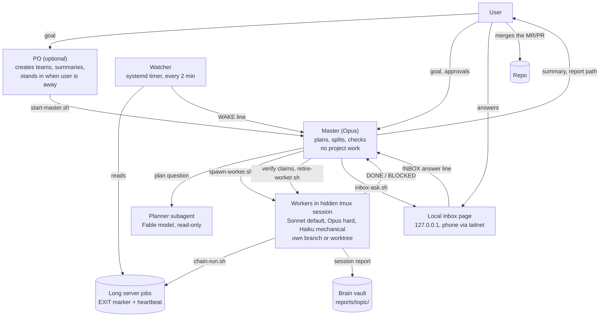

# claude-harness: how I work with AI agents

This is my personal setup for Claude Code. I use it every day for my own work.
It is a set of skills, shell and Python scripts, hooks and templates around the `claude` CLI.
It is not a product. It fits my machine and my habits. Read it for ideas, and copy the parts that help you.

## 1. The problem

One Claude session is good at one task. My work has many tasks at the same time, and some run for hours on GPU servers.
A single long chat runs out of context, forgets what it did, and stops when I am away.
I also found that agents report work that they did not check, and they try to route around blocks.
I wanted many agents to work in parallel, with checks, while I stay in control of every decision that matters.

## 2. The loop



The same diagram is in `docs/loop.mmd`.

1. I give a goal to a **master**. The master is a Claude session that plans and checks. It does no project work itself.
2. For a hard plan, the master asks a read-only **planner** subagent (Fable model). This is my habit. No script enforces it.
3. The master splits the plan into task files. I approve the plan.
4. The master starts **workers**. Each worker is a Claude session in a hidden tmux session, usually on its own branch or worktree.
   The master picks the model per task: Sonnet by default, Opus for hard tasks, Haiku for mechanical tasks.
   Short tasks run as background subagents instead.
5. A worker starts long server jobs only through `chain-run.sh`. Each job writes an `EXIT` marker and a heartbeat.
6. The **watcher** (a systemd timer, every 2 min) reads the jobs. When a job ends or stalls, it types one `WAKE` line into the master pane.
7. When a worker finishes, it writes a **session report** to my brain vault and sends `DONE` to the master.
8. The master checks the key claims itself (it reads the files and logs), then retires the worker. The script refuses a report that fails the schema check.
9. I merge the MR/PR myself. No agent merges.
10. When an agent needs me, it puts a question on a **local inbox page**. I answer on my phone. The answer arrives in the agent's pane as one typed line.

An optional **PO** (product owner) session creates teams and writes summaries across teams. It stands in for me only when I say "I am away".

## 3. Parts and what each solves

| Part | Where | What it solves |
|---|---|---|
| Global rules | `claude/CLAUDE.md` | Two rules for every session: YAGNI, and plain short English (ASD-STE100). |
| Settings | `claude/settings.json` | Model, effort level, permissions and the four orchestra hooks. `install.sh` never writes it; merge it by hand. |
| Worker settings | `claude/worker-settings.json` | A deny list for workers: no push to main, no force push, no merge, no `rm -rf`, no deletes over ssh. |
| Skills | `skills/` | Role protocols for the agents (table below). |
| Orchestra | `orchestra/` | About 4,400 lines of bash and Python: spawn, retire, registry, chains, watcher, inbox, report checks. See `orchestra/README.md`. |
| Hooks | `orchestra/hooks/` | Code checks on agent actions: message envelopes, the contract, bundled deletes, a stop guard. |
| Lessons | `orchestra/lessons/` | A library of lessons with evidence. The master pastes the matching lessons into each task file. |
| Harness2 | `orchestra/h2/` | An improve loop for skills: propose a small skill change, test it with headless probe runs, ask me to apply it. |
| Brain | `brain-template/` | An Obsidian vault with git. All session reports go here, one folder per topic, with an index and a tag glossary. |
| Project template | `project-template/` | A project `CLAUDE.md` (readability rules, test-driven development, writing style) and a code quality gate. |
| systemd units | `systemd/` | Watcher timer, inbox server, weekly improve ask, daily vault commit and consolidation. |
| tmux snippet | `tmux/tmux.conf.snippet` | Keeps a live tmux board in the vault. |
| Two config dirs | `examples/launch-po.sh` | I run a second Claude account with `CLAUDE_CONFIG_DIR=~/.claude-b`. It links `CLAUDE.md`, `skills/` and `hooks/` to `~/.claude`. Only `settings.json` differs. |
| Status line | none | I do not use a custom status line. |

### Skills

| Skill | What it does |
|---|---|
| `orchestrate` | Runs a session as the master: plan, spawn, check in, verify, retire, restart itself at 500k tokens. |
| `worker` | The worker protocol: stay in the task, do not route around blocks, report `DONE` or `BLOCKED` in a fixed format. |
| `po` | Runs a session as the product owner: create teams, summarize, away mode with clear limits. |
| `inbox` | Asks me a question on the local inbox page, and acts on the answer line. |
| `session-report` | Writes a self-contained report to the brain vault, so a fresh session can continue. |
| `resurect` | Hands the work to a fresh chat in tmux and closes the current one. (The name has a typo. I keep it, because my muscle memory types it.) |
| `rclone` | Uploads to and downloads from Google Drive, with safe defaults (`copy`, never `sync` without asking). |

## 4. A day with it

- In the morning I open the inbox page on my phone. It lists every open question from every team.
- I start a team: I ask the PO for it, or I use the "New team" form on the inbox page.
- I tell the master the goal in its tmux window. It shows a plan. I say yes or change it.
- Workers start. I do other work. I do not watch their windows.
- When a server job ends, the watcher wakes the master. The master checks the result and starts the next task.
- Questions come to the inbox page. I answer with one tap, or I ask "Explain".
- The master sends me a 5-line summary and a report path for each finished task.
- When I go out, I tell the PO "I am away". It answers routine questions inside fixed limits.
- In the evening I review the MRs and merge them myself.
- Each session writes a report before it ends, so tomorrow starts from the report, not from memory.

## 5. Honest limits

- It fits my machine. Paths, tmux layout and the systemd units assume Linux, tmux and one user.
- The deny rules match command text only. `bash -c '...'` or `/bin/rm` gets past them. The hooks and the worker skill reduce this. They do not close it.
- My settings use bypass permissions with a broad allow list. That is my choice on my own machine. It is not safe for a shared machine.
- The master checks claims with reads only. It does not re-run jobs.
- The watcher reads Claude's pane text and session files. A Claude Code update can change those formats and break the wakes.
- Many agents cost many tokens. Usage limits are real; the watcher only resumes sessions after a reset.
- Some parts depend on tools that are not in this repo: my work GPU servers, and a GPU lease script for a shared job queue. I removed them.
- The automated tests cover the hooks and the example project only. The rest I tested by hand (see `orchestra/TEST.md`) and in daily use.
- The lesson library here is a subset. Most evidence points to internal reports that I cannot publish.

## 6. Install and test

Requirements: Linux, `claude`, `tmux`, `jq`, `python3` with `pyyaml`, `flock`. Optional: `systemd --user`, Tailscale for the phone.

```bash
git clone <this repo> ~/dev/claude-harness
cd ~/dev/claude-harness
./install.sh                  # dry run: prints what it would do, changes nothing
./install.sh --link           # symlink into ~/.claude (never overwrites a file)
./install.sh --link --systemd # also install the systemd user units
./install.sh --link --brain   # also copy the vault template to $BRAIN_DIR (default ~/brain)
```

Then merge the `hooks` block of `claude/settings.json` into `~/.claude/settings.json` by hand.

Test:

```bash
cd orchestra/hooks && python3 -m unittest test_orch_hooks   # hook tests
cd project-template && make check                           # the quality gate on the example code
```

Start a team:

```bash
~/.claude/orchestra/start.sh ~/dev/my-project   # then type in the master window: /orchestrate <goal>
```

## 7. Code quality gate

`project-template/` has a gate that blocks broken or messy code before a commit.

- `scripts/check.sh` (or `make check`) runs four steps: `ruff check`, `ruff format --check`, `tools/loc_check.py`, `pytest`.
- `tools/loc_check.py` counts lines of code (no blank lines, comments or docstrings). Limits: file 300, class 200, function 60.
  You set them in `[tool.loc_check]` in `pyproject.toml`. Old code that is already too long goes into a baseline file. A listed item may only shrink.
- `.claude/hooks/check_before_commit.py` is a Claude Code hook. It runs the gate before `git commit` and `gh pr create`, and blocks the command when the gate fails. It also blocks `--no-verify`.
- The project `CLAUDE.md` asks for test-driven development: a failing test first, then the code, then a refactor. Every bug fix starts with a test that shows the bug.

Example. A function with 62 lines of code gives:

```
BLOCK src/textstats/long.py::too_long = 62 LOC (limit 60)
```

and the hook stops the commit with exit code 2.

## 8. Lessons that changed the design

Each lesson came from a real failure. The full table is in `orchestra/lessons/INDEX.md`.

| Lesson | What happened | What changed |
|---|---|---|
| L-003 | A setup command with `rm -rf` inside was denied as a whole. Agents then thought all steps were forbidden. | Workers never bundle a delete with other steps. A hook blocks bundled deletes. |
| L-004 | Agents tried to pass "the user approved" through another session, or to split a blocked command. | A message never grants permission. A block goes to me, in that window. |
| L-006 | Masters ran out of context and lost the team state. | The master keeps a handoff file current. At 500k tokens the watcher wakes it, and it restarts itself from the file. Workers keep running. |
| L-007 | Workers hit the context limit in the middle of a task. | The master rotates a worker to a fresh one, with a state note, before the limit. |
| L-011 | Agents relayed numbers they had not read in the output files. | The master re-reads key numbers before it reports. Each claim is marked measured, inferred or retracted. |
| L-013 | Messages between sessions on two accounts, or in two permission modes, got lost. | A team and its PO run in one account and one permission mode. |
| L-014 | Keys typed into a tmux pane were lost (view mode, a lost Enter). | Agents never use `send-keys`. Only code sends one fixed wake line, and it checks that the line left the input box. |
| L-016 | A master missed an inbox answer when the wake failed. | The master also reads the answers file at each check-in, and acts once on an answer that arrives twice. |

## 9. Links

- My site: https://ilyaeis.github.io
- `orchestra/README.md`: the details of every script.
- `docs/scrub-checklist.md`: how I removed private data from this repo.

License: MIT.
